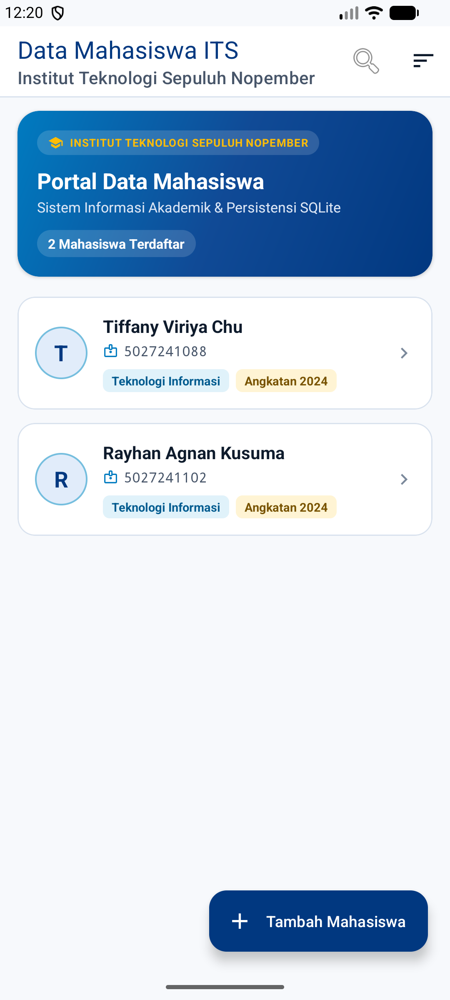
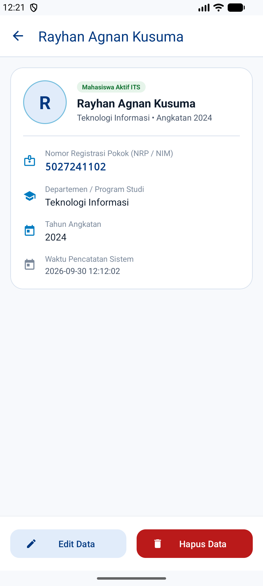
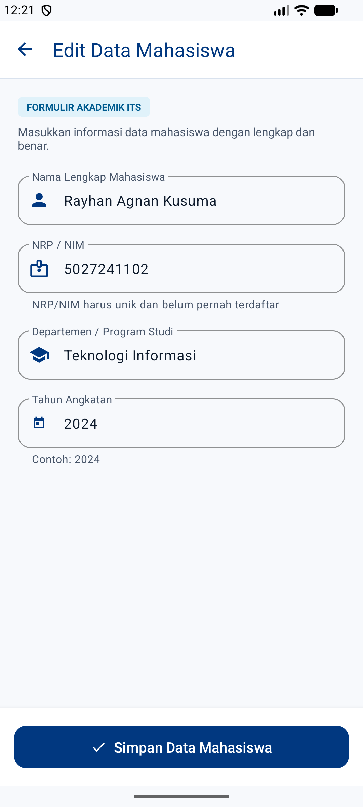
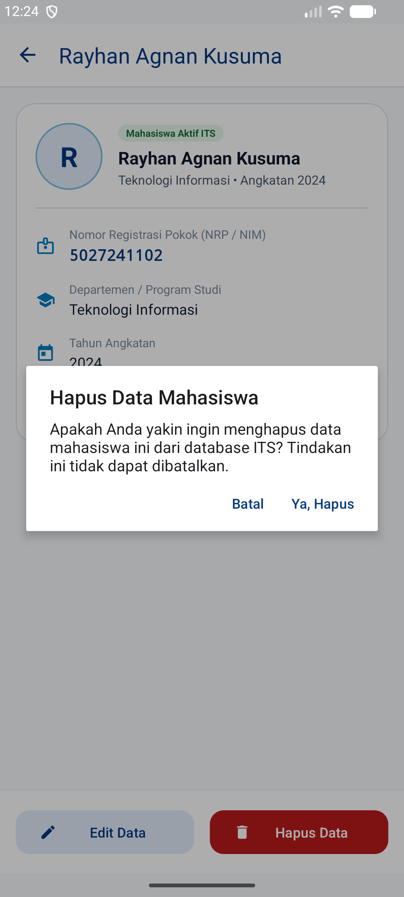

# 🎓 Aplikasi Data Mahasiswa ITS (Tugas 4 Pemrograman Mobile)

[](https://developer.android.com)
[](https://www.java.com)
[](https://www.sqlite.org)
[](https://www.its.ac.id)
[](https://m3.material.io)

Aplikasi manajemen data mahasiswa berbasis Android yang dibangun dengan standar **Material Design 3 (M3)** dan menerapkan identitas visual resmi **ITS Brand Guidelines**. Proyek ini dikembangkan untuk memenuhi rubrik penilaian **Tugas 4: Fungsionalitas, Kebenaran Skema & Query SQLite, Uji Persistensi Data** pada mata kuliah Pemrograman Mobile.

---

## 🎨 Implementasi ITS Brand Guidelines

Sistem pewarnaan antarmuka secara disiplin mengadopsi panduan identitas visual resmi Institut Teknologi Sepuluh Nopember (ITS):

| Kategori Warna | Elemen Brand | HEX Code | Implementasi pada UI |
|---|---|:---:|---|
| **Primer** | Biru Cover | `#243E80` | Background hero banner & aksen kontras |
| **Primer** | Biru Tua Lambang | `#007BC0` | Gradient aksen banner & header card |
| **Primer** | Biru Muda Lambang | `#75BEDE` | Chip Departemen / Program Studi & focused stroke |
| **Primer** | Kuning Lambang | `#FFF200` | Chip Tahun Angkatan & status highlight |
| **Sekunder** | Biru Tua (Web/UI) | `#013880` | Primary color, AppBar header & Extended FAB |
| **Sekunder** | Kuning Tua (Web/UI)| `#FFBD07` | Tag badge institusi & indikator aktif |

---

## 📌 Pemenuhan Rubrik Penilaian Tugas 4

| Kriteria | Implementasi | Status |
|---|---|:---:|
| **1. Fungsionalitas CRUD Lengkap** | **Create:** Input data baru via `MahasiswaFormActivity`<br>**Read:** List interaktif di `MainActivity` ber-kartu M3<br>**Update:** Edit data via form pra-terisi<br>**Delete:** Hapus data dengan dialog konfirmasi aman M3 | ✅ **100% Lengkap** |
| **2. Fitur Pencarian & Filter** | Pencarian *real-time* berbasis Nama, NRP, atau Jurusan, serta menu multi-kriteria sort (Terbaru, Terlama, Nama A-Z, NRP) | ✅ **100% Lengkap** |
| **3. Kebenaran Skema SQLite** | Menggunakan `SQLiteOpenHelper` dengan skema DDL: `id` (PK AUTOINCREMENT), `nim`/`nrp` (TEXT NOT NULL UNIQUE), `nama` & `jurusan` (TEXT NOT NULL), `angkatan` (INTEGER NOT NULL), `timestamp` (DATETIME DEFAULT CURRENT_TIMESTAMP) | ✅ **100% Benar** |
| **4. Kebenaran Query SQLite** | Seluruh query mutasi (INSERT, UPDATE, DELETE) & baca (SELECT) menggunakan *parameterized queries* (`?`) dan `ContentValues` untuk proteksi total terhadap *SQL Injection*. Penutupan `Cursor` terjamin dalam blok `finally`. | ✅ **100% Aman** |
| **5. Uji Persistensi Data** | Siklus koneksi database dikelola secara rapi di `onStart()` dan `onStop()`. Data diverifikasi tetap tersimpan 100% setelah aplikasi dimatikan paksa (*force-stop*) dan dibuka kembali (*cold restart*). | ✅ **100% Persisten** |
| **6. Kualitas UI/UX M3 & ITS Brand** | Menggunakan *Google Material Design 3* dengan identitas ITS: *Hero Banner Card*, *monogram initial avatar*, *pills & badges*, `TextInputLayout` dengan ikon penanda, serta FAB adaptif scroll. | ✅ **100% Premium** |

---

## 👨‍🎓 Data Mahasiswa Awal (Dummy Data Terdaftar)

Pada inisialisasi awal database (`mahasiswa.db`), sistem secara otomatis menyertakan data mahasiswa:

1. **Rayhan Agnan Kusuma**
   - **NRP / NIM:** `5027241102`
   - **Departemen:** Teknologi Informasi
   - **Angkatan:** 2024
2. **Tiffany Viriya Chu**
   - **NRP / NIM:** `5027241088`
   - **Departemen:** Teknologi Informasi
   - **Angkatan:** 2024

---

## 🗄️ Skema Database SQLite (`mahasiswa.db`)

Didefinisikan dalam kelas `com.example.diaryapp.data.DbHelper`:

```sql
CREATE TABLE mahasiswa (
    id        INTEGER PRIMARY KEY AUTOINCREMENT,
    nama      TEXT NOT NULL,
    nim       TEXT NOT NULL UNIQUE,
    jurusan   TEXT NOT NULL,
    angkatan  INTEGER NOT NULL,
    timestamp DATETIME DEFAULT CURRENT_TIMESTAMP
);
```

---

## 🖼️ Tampilan Antarmuka & Hasil Pengujian

| 1. Daftar Mahasiswa ITS (Hero Banner M3) | 2. Detail Profil Mahasiswa (Rayhan) |
|:---:|:---:|
|  |  |

| 3. Formulir Data Mahasiswa (M3 Outlined) | 4. Dialog Konfirmasi Hapus Data |
|:---:|:---:|
|  |  |

---

## 🏗️ Struktur Arsitektur Kode

```
app/src/main/
├── AndroidManifest.xml
├── java/com/example/diaryapp/
│   ├── data/
│   │   ├── Mahasiswa.java              # Model Entity POJO
│   │   ├── DbHelper.java               # SQLiteOpenHelper, DDL & Seeding Data ITS
│   │   └── MahasiswaRepository.java    # Data Access Object (CRUD, Parameterized Query)
│   └── ui/
│       ├── MainActivity.java           # Layar Utama, Hero Banner, Search, Sort & Lifecycle
│       ├── MahasiswaAdapter.java       # Adapter RecyclerView, Monogram Avatar, ITS Chips
│       ├── MahasiswaFormActivity.java  # Form Tambah/Edit Mahasiswa & Validasi Input
│       └── MahasiswaDetailActivity.java# Detail Mahasiswa, Monogram & Dialog Hapus M3
└── res/
    ├── drawable/                       # Hero gradient ITS, Chip drawables, Monogram circles
    ├── layout/                         # XML Layouts (CoordinatorLayout, M3 Cards, Outlined Inputs)
    ├── menu/                           # Menu Pencarian Real-time & Sortir
    └── values/                         # ITS Color Tokens, M3 Typography & String Resources
```

---

## 🚀 Cara Menjalankan Proyek

1. **Clone repository ini:**
   ```bash
   git clone https://github.com/knownasrayy/PEMMOB-5027241102-TUGAS4.git
   ```
2. **Buka dengan Android Studio** (Ladybug / Koala atau versi lebih baru).
3. **Sinkronkan Gradle** (*Sync Project with Gradle Files*).
4. **Jalankan pada Emulator atau Perangkat Fisik** (Min SDK: 24, Target SDK: 37).