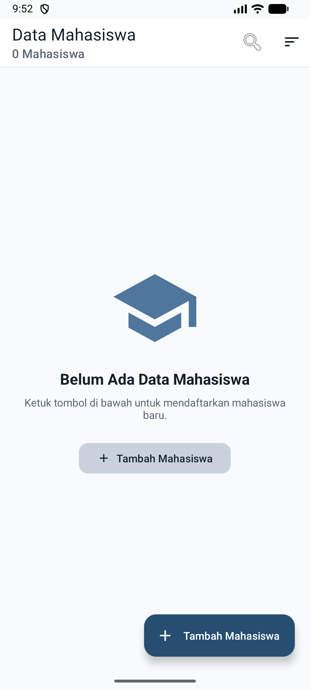
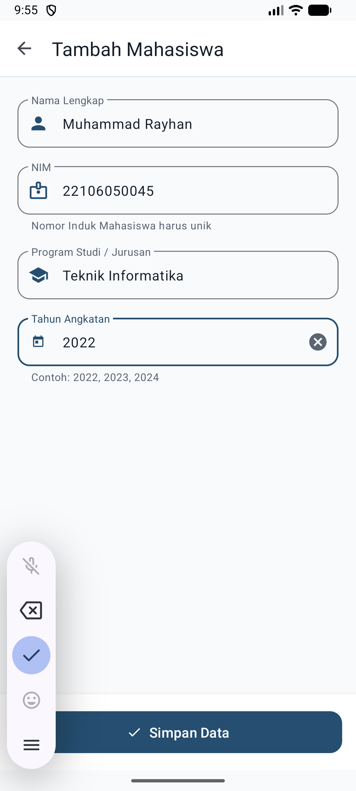
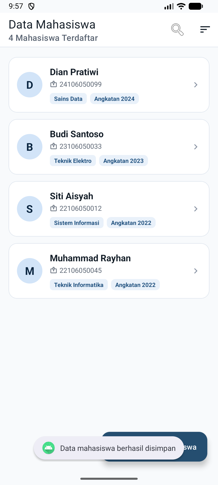
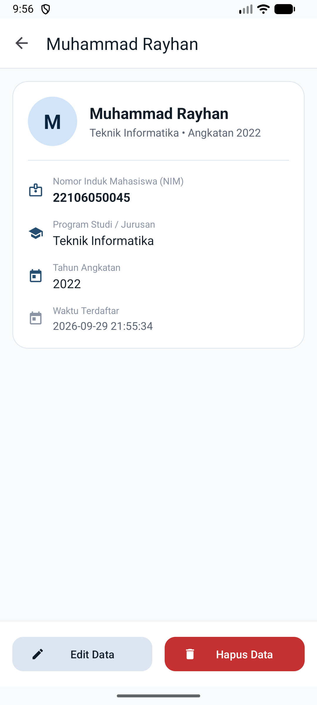
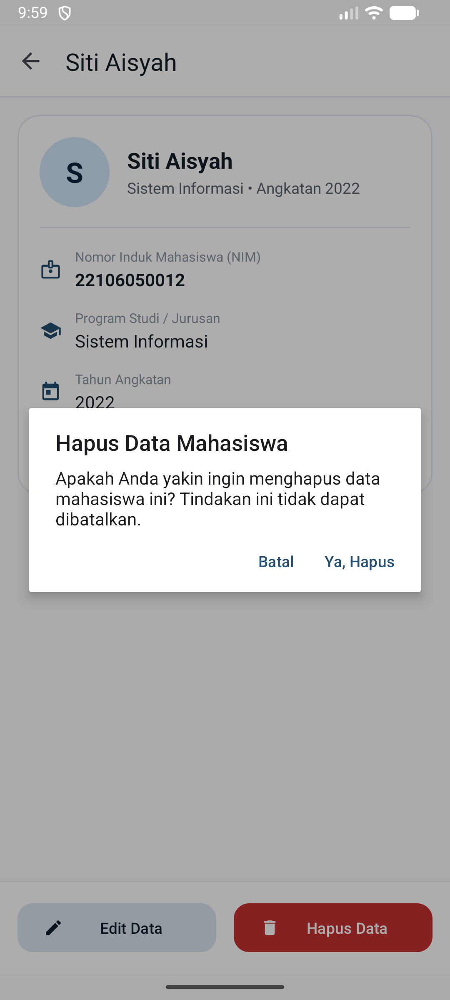
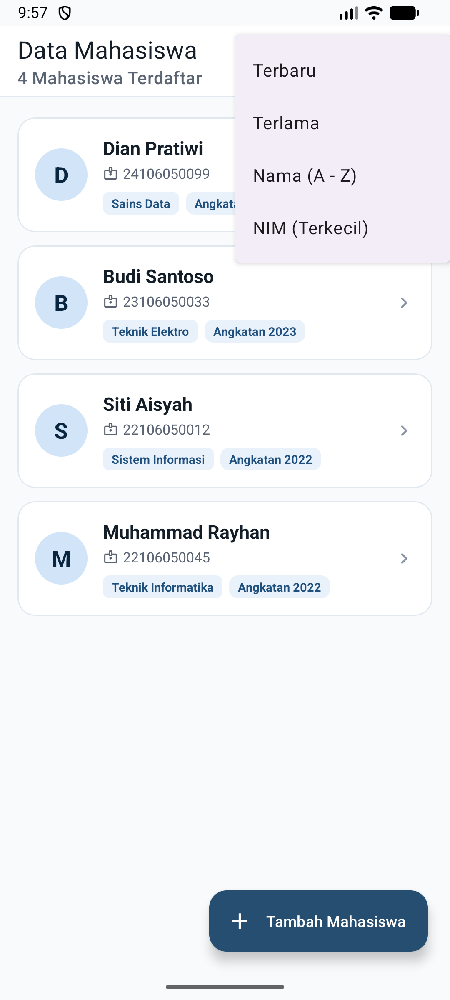

# Aplikasi Data Mahasiswa (Tugas 4 Pemrograman Mobile)

[](https://developer.android.com)
[](https://www.java.com)
[](https://www.sqlite.org)
[](https://m3.material.io)

Proyek ini dibangun untuk memenuhi kriteria **Tugas 4: Fungsionalitas, Kebenaran Skema & Query SQLite, Uji Persistensi Data** pada mata kuliah Pemrograman Mobile. Aplikasi menyajikan manajemen data mahasiswa secara *offline-first* dengan arsitektur *Repository Pattern*, query aman dari *SQL Injection*, serta antarmuka modern Material Design 3 (M3).

---

## 📌 Pemenuhan Rubrik Penilaian Tugas 4

| Kriteria | Implementasi | Status |
|---|---|:---:|
| **1. Fungsionalitas CRUD** | **Create:** Input data baru via `MahasiswaFormActivity`<br>**Read:** Tampil list via `RecyclerView` ber-kartu M3<br>**Update:** Edit data mahasiswa via Form Mode Edit<br>**Delete:** Hapus data dengan dialog konfirmasi aman | ✅ **Lengkap** |
| **2. Fitur Pencarian & Filter** | Pencarian *real-time* berbasis Nama, NIM, atau Jurusan, serta menu multi-kriteria sort (Terbaru, Terlama, Nama A-Z, NIM) | ✅ **Lengkap** |
| **3. Kebenaran Skema SQLite** | Menggunakan `SQLiteOpenHelper` dengan DDL: `id` (PK AUTOINCREMENT), `nim` (TEXT NOT NULL UNIQUE), `nama` & `jurusan` (TEXT NOT NULL), `angkatan` (INTEGER NOT NULL), `timestamp` (DATETIME DEFAULT CURRENT_TIMESTAMP) | ✅ **Lengkap** |
| **4. Kebenaran Query SQLite** | Semua manipulasi data menggunakan *parameterized queries* (`?`) dan `ContentValues` untuk proteksi total terhadap serangan *SQL Injection*. Penutupan `Cursor` selalu terjamin di blok `finally`. | ✅ **Lengkap** |
| **5. Uji Persistensi Data** | Siklus koneksi database dikelola secara rapi di `onStart()` dan `onStop()`. Data telah diuji tetap tersimpan 100% setelah aplikasi dimatikan paksa (*force-stop*) dan dibuka kembali (*cold restart*). | ✅ **Lengkap** |
| **6. Kualitas UI/UX M3** | Menggunakan *Google Material Design 3*: palet warna *Deep Slate Indigo*, *monogram initial avatar*, *pills & badges*, `TextInputLayout` dengan ikon penanda, serta FAB adaptif scroll. | ✅ **Lengkap** |

---

## 🗄️ Skema Database SQLite (`mahasiswa.db`)

Didefinisikan dalam kelas `com.example.diaryapp.data.DbHelper`:

```sql
CREATE TABLE mahasiswa (
    id        INTEGER PRIMARY KEY AUTOINCREMENT,
    nama      TEXT NOT NULL,
    nim       TEXT NOT NULL UNIQUE,
    jurusan   TEXT NOT NULL,
    angkatan  INTEGER NOT NULL,
    timestamp DATETIME DEFAULT CURRENT_TIMESTAMP
);
```

---

## 🖼️ Tampilan Antarmuka & Hasil Pengujian

| 1. Status Kosong (*Empty State*) | 2. Form Input Mahasiswa (M3) |
|:---:|:---:|
|  |  |

| 3. Daftar Mahasiswa Terdaftar | 4. Detail Profil Mahasiswa |
|:---:|:---:|
|  |  |

| 5. Dialog Konfirmasi Hapus | 6. Menu Urutan Sortir & Persistensi |
|:---:|:---:|
|  |  |

---

## 🏗️ Struktur Arsitektur Kode

```
app/src/main/
├── AndroidManifest.xml
├── java/com/example/diaryapp/
│   ├── data/
│   │   ├── Mahasiswa.java             # Model Entity POJO
│   │   ├── DbHelper.java              # SQLiteOpenHelper & DDL
│   │   └── MahasiswaRepository.java   # Data Access Object (CRUD & Parameterized Query)
│   └── ui/
│       ├── MainActivity.java          # Layar Utama, Search, Sort & Lifecycle
│       ├── MahasiswaAdapter.java      # Adapter RecyclerView & Monogram
│       ├── MahasiswaFormActivity.java # Form Tambah / Edit & Validasi Input
│       └── MahasiswaDetailActivity.java# Detail Mahasiswa & Dialog Hapus
└── res/
    ├── layout/                        # Desain Layout XML Material Design 3
    ├── menu/                          # Menu Pencarian & Sortir
    └── values/                        # Color Tokens, Themes, & Strings
```

---

## 🚀 Cara Menjalankan Proyek

1. **Clone repository ini:**
   ```bash
   git clone https://github.com/knownasrayy/PEMMOB-5027241102-TUGAS4.git
   ```
2. **Buka dengan Android Studio** (Ladybug / Koala atau versi lebih baru).
3. **Sinkronkan Gradle** (*Sync Project with Gradle Files*).
4. **Jalankan pada Emulator atau Perangkat Fisik** (Min SDK: 24, Target SDK: 37).